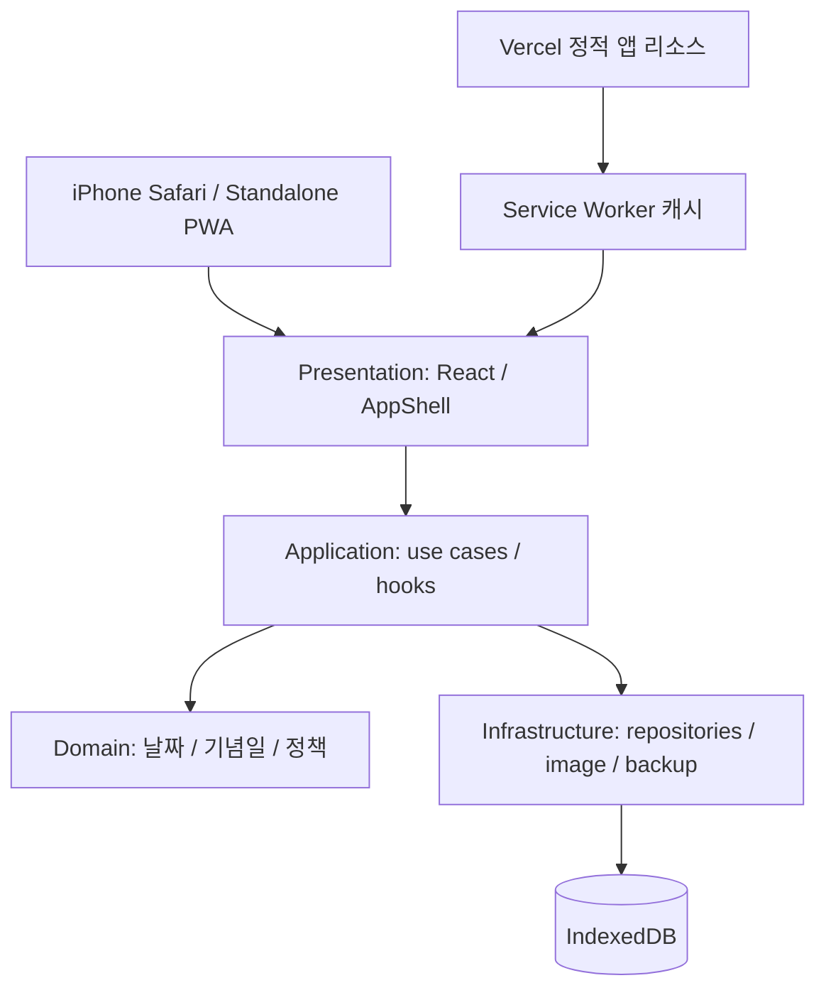

# 커플 디데이 PWA — 시스템 아키텍처 및 데이터베이스 설계

- 버전: 1.1 / 아키텍처 정책 확정본
- 기준일: 2026-11-25 (2026-11-26 Phase 0: 버전 확정 §4.1, 문서 정합화)
- 대상: iPhone Safari 및 홈 화면 설치형 PWA
- 선행 명세: `.agents/skills/dday-design/SKILL.md`, `REQUIREMENTS.md` v1.1
- 후속 명세: `AGENTS.md`, `TEST_CASES.md`
- 상태: 설계 확정. Phase 0(프로젝트 초기화, 라이브러리 호환성 검증, 폰트 확보) 완료. 기능 구현 및 실기기 검증은 미수행.

## 1. 적용 원칙 및 문서 간 우선순위

- MUST: 확정된 기능과 디자인을 유지한다. 본 문서는 구현 구조 및 이번에 사용자가 승인한 추가 정책을 정의한다.
- MUST NOT: 구현 편의에 따라 기능, 색상, 폰트, 배치, 문구, 메뉴 순서를 임의 변경하지 않는다.
- 시각적 표현은 SKILL.md, 기능은 REQUIREMENTS.md, 기술 구조는 본 문서를 따른다. 이번 A~E 승인 정책은 기존 문서의 미확정 세칙 및 상충하는 이전 제안보다 우선한다.
- 메인 원형 진행률(자동 기념일만)과 기념일 강조 카드 진행률(자동+사용자 지정)은 분리 계산한다(§7.1). SKILL.md §10에도 동일하게 반영되어 있다. 디자인 자체는 변경하지 않는다.
- REQUIREMENTS.md §19의 승인 항목은 본 문서로 해소하며, 2026-11-26 정합화에서 REQUIREMENTS.md v1.1 해당 항목에 ARC ID로 반영했다.
- 신규 UI의 상세 배치와 미승인 시각적 결정은 사용자 확인 후 구현한다.

## 2. 확정 정책 추적표

| ID | 확정 정책 | 관련 기존 요구사항 |
|---|---|---|
| ARC-A01 | 시작일 변경으로 기존 사용자 지정 기념일이 시작일 이전이 되어도 기념일 및 추억 유지, 신규 등록만 제한 | SET-E06, CUS-003 |
| ARC-A02 | 매년 반복 기념일 수정 시 해당 연도만 또는 전체 반복 선택 | CUS-005, CUS-011 |
| ARC-A03 | 매년 반복 기념일 삭제 시 해당 연도만 또는 전체 반복 선택 | CUS-006, SET-017 |
| ARC-A04 | 반복 2월 29일은 평년 2월 28일 | CUS-E07 |
| ARC-A05 | 등록 날짜의 연도부터 반복, 소급 생성 없음 | CUS-004 |
| ARC-A06 | 전체 반복 수정 시 기존 개별 연도 수정(override)·삭제(cancelled) 유지 (2026-11-26 승인) | CUS-005 |
| ARC-A07 | 전체 반복 수정은 월·일만 변경, 시작(등록) 연도 고정 (2026-11-26 승인) | CUS-005, CUS-011 |
| ARC-A08 | 해당 연도만 수정 시 같은 연도 안에서만 날짜 이동 (2026-11-26 승인) | CUS-005, CUS-011 |
| ARC-A09 | 일회성↔매년 반복 유형 전환 미제공(삭제 후 재등록) (2026-11-26 승인) | CUS-004, CUS-011 |
| ARC-B01 | 사진 중복 검사는 같은 기념일 내에서만 | MEM-011 |
| ARC-B02 | 원본 파일 SHA-256 해시 사용 | MEM-E07 |
| ARC-B03 | 대표 사진 삭제 시 남은 첫 사진을 대표로 지정 | MEM-E09 |
| ARC-B04 | 사진 순서 변경 시 기존 대표 유지 | MEM-010 |
| ARC-B05 | 사진 없는 메모 단독 등록 허용 | MEM-013 |
| ARC-B06 | 설정 변경으로 미래가 된 기존 메모 조회 및 수정 허용 | SET-016 |
| ARC-B07 | 프로필 512px, 추억 1920px, 품질 0.85 초기값 | MEM-006 |
| ARC-B08 | 사진은 압축 이미지 바이트(ArrayBuffer)+mimeType으로 저장하고 표시·내보내기 시 Blob으로 변환 (2026-11-26 승인) | MEM-006, MEM-007 |
| ARC-C01 | 가장 가까운 기념일 강조, 카드 진행률은 직전 기념일부터 별도 계산 | TML-016, ANN-009 |
| ARC-C02 | 가장 가까운 날짜에 겹치는 기념일 모두 강조 | TML-015 |
| ARC-C03 | 미래 자동 기념일 1년씩 추가 로딩 | TML-014 |
| ARC-C04 | 스와이프 양 끝에서 중단 | NAV-003 |
| ARC-C05 | 단일 AppShell 내부 화면 전환 | NAV-001~004 |
| ARC-D01 | 복원 후 마지막 백업 일시는 백업 생성 일시 | SET-013, RES-009 |
| ARC-D02 | 미래 시작일 백업 복원 차단, 기기 날짜 확인 안내 | RES-E09 |
| ARC-D03 | 압축 해제 총량 초기 상한 256MiB, 실기기 테스트 후 조정 | RES-E05 |
| ARC-D04 | 파일 생성 및 공유/다운로드 전달 완료를 성공 기준으로 사용, 실제 보존 보장 없음 | BAK-012 |
| ARC-E01 | Zod, dexie-react-hooks, fake-indexeddb 추가 | NFR-012 |
| ARC-E02 | Playwright 스크린샷 비교 | NFR-011~013 |
| ARC-E03 | DB 커밋 성공 후 UI 갱신 | SET-007, NFR-006 |

## 3. 시스템 구조

Local-first 단일 클라이언트 앱. 로그인, 광고, 서버 DB, 클라우드 동기화, 커플 간 공유 없음. 한국어만 지원하되 기존 TOGETHER/DAYS/D-DAY 문구 유지. 기기당 단일 커플, 라이트모드 Dusty Rose 고정.



| 계층 | 책임 | 의존성 제한 |
|---|---|---|
| Presentation | 화면, 입력, 접근성, 공통 UI | DB 직접 변경 금지 |
| Application | 유스케이스, 검증, 트랜잭션 조율 | Domain 및 Infrastructure 사용 |
| Domain | 날짜/진행률/식별자/정책 순수 함수 | React, Dexie, 브라우저 API 의존 금지 |
| Infrastructure | DB, 이미지, ZIP, 브라우저 어댑터 | UI 의존 금지 |

서버에는 정적 앱 리소스만 배포한다. 개인 데이터, 사진, 메모, 백업을 API, 로그, 분석 도구로 전송하지 않는다. 브라우저 API는 클라이언트 경계 안에서만 호출하며 SSR 중 IndexedDB 접근 금지.

## 4. 기술 스택

| 기술 | 역할 |
|---|---|
| Next.js App Router / React / TypeScript | 앱 셸 및 UI, 타입 |
| Tailwind CSS / CSS Variables | 공통 디자인 토큰 |
| Zustand | 일시적 UI 상태 |
| IndexedDB / Dexie.js / dexie-react-hooks | 영속 데이터, 트랜잭션, 반응형 조회 |
| date-fns | 달력 날짜 계산 |
| Motion | 화면 전환 및 제스처 |
| Lucide React / Custom SVG | 확정 아이콘, 원형 진행률 |
| Serwist | Service Worker 및 오프라인 앱 셸 |
| JSZip | ZIP 생성 및 검증된 아카이브 처리 |
| Zod | 외부 데이터 및 입력 검증 |
| Canvas / Web Crypto | 이미지 변환 / SHA-256 |
| Vitest / fake-indexeddb | 단위 및 DB 통합 테스트 |
| Playwright | E2E 및 시각 회귀 테스트 |
| Vercel | HTTPS 배포 |
| Canvas API | 자동 주년 당일 금빛 꽃가루 애니메이션 |
| requestAnimationFrame | 축하 애니메이션 프레임 제어 |
| Cormorant Garamond | 주년 전용 숫자 및 영문 축하 문구 |

버전은 §4.1과 같이 정확한 버전(`--save-exact`)과 `package-lock.json`으로 고정한다. ZIP 안전 상한을 JSZip으로 강제할 수 없는 경우 제한된 스트리밍 압축 해제 어댑터의 추가 도입을 검토하고 승인받는다(§4.4 스파이크 결과 참조).
- 축하 애니메이션은 브라우저 기본 Canvas API를 사용한다.
- 별도의 애니메이션 라이브러리 추가 없이 구현한다.
- 기존 Motion은 화면 전환 및 공통 UI 애니메이션에 사용한다.
- 주년 전용 폰트는 로컬 리소스로 관리한다.

### 4.1 확정 버전 (2026-11-26 검증)

실행 환경: Node.js 24.20.0, npm 11.19.0 (package.json `engines.node >=22.12.0`, Vitest 5 요구사항). 패키지 매니저는 기존 설정이 없어 Node 기본 npm을 사용한다.

| 패키지 | 버전 | 선정 근거 |
|---|---|---|
| next | 16.4.6 | 16.4 라인 최신 패치. `create-next-app@16.4.6` 공식 템플릿 기준 |
| react / react-dom | 19.3.1 | Next 16 peer `^19.0.0` 충족. 템플릿 고정값 19.3.0의 패치 릴리스 |
| typescript | 5.9.3 | 템플릿 `^5`. TS 7.x/6.1+는 typescript-eslint(`<6.1.0`) 미지원 |
| tailwindcss / @tailwindcss/turbopack | 4.3.5 | Next 16.4 템플릿의 Turbopack 로더 방식. CSS-first 토큰(`@theme`) |
| zustand | 5.1.0 | React 18+/19 지원 |
| dexie / dexie-react-hooks | 4.4.7 / 4.4.0 | dexie-react-hooks peer `dexie >=4.2.0-alpha.1 <5`, `react >=16` |
| date-fns | 4.4.0 | 5.x는 alpha. 4.x 안정 라인 |
| lucide-react | 1.70.0 | 일 단위로 릴리스되는 패키지이므로 2주 이상 경과한 버전 선택 |
| motion | 14.10.1 | 잦은 릴리스로 2주 이상 경과한 버전 선택. React 19 지원 |
| zod | 4.6.7 | GHSA-mrhx-c7xc-m3w5(`<4.6.6`) 수정 버전 |
| jszip | 3.10.2 | 유일한 안정 라인 |
| serwist / @serwist/turbopack | 9.5.15 | 9.5 라인 보안 패치(`@serwist/build <=9.5.14` 하위 의존성 취약점 수정). 9.6.0(2026-11-25)은 출시 직후라 보류 |
| esbuild-wasm | 0.28.2 | @serwist/turbopack peer(`>=0.25 <1`). 비Windows 기본 번들러 |
| vitest | 5.0.5 | 5.0 라인 안정 패치. 5.1.2는 출시 직후라 보류 |
| fake-indexeddb | 6.2.8 | IndexedDB 통합 테스트 |
| @playwright/test | 1.65.1 | Next 16 peer `^1.51.1` 충족 |
| eslint / eslint-config-next | 9.39.5 / 16.4.6 | eslint-plugin-react가 ESLint `^9.7`까지만 지원하므로 ESLint 10 미채택 |
| @types/node / @types/react / @types/react-dom | 24.19.2 / 19.3.0 / 19.3.0 | Node 24 런타임, React 19.3 타입 |

`npm audit` 결과 0건(2026-11-26). 신규 런타임 라이브러리는 추가하지 않았다. esbuild-wasm은 확정 스택(Serwist Turbopack 통합)의 필수 peer 의존성이다.

### 4.2 폰트 및 라이선스

| 폰트 | 파일 (`public/fonts/`) | 출처 | 라이선스 |
|---|---|---|---|
| Pretendard | `pretendard/PretendardVariable.woff2` (가변 45~920, 2.0MB) | npm `pretendard@1.3.9` 배포 파일 | SIL OFL 1.1 (Kil Hyung-jin) |
| 마루 부리 | `maruburi/MaruBuri-Regular.woff2`, `MaruBuri-SemiBold.woff2` | NAVER 공식 웹폰트(hangeul.pstatic.net) 원본 그대로 | SIL OFL 1.1 (NAVER, help.naver.com 공식 안내 확인) |
| Cormorant Garamond | `cormorant-garamond/...-latin-400-normal.woff2`, `...-latin-500-italic.woff2` | npm `@fontsource/cormorant-garamond@5.3.0` 배포 파일 | SIL OFL 1.1 (The Cormorant Project Authors) |

- 각 폴더에 `LICENSE.txt`를 함께 배포한다. 폰트 파일은 수정(서브셋/변환)하지 않았다.
- Pretendard는 400/500/600/700을 모두 사용하므로 정적 4종(약 3.1MB) 대신 가변 폰트 1종(2.0MB)을 사용한다.
- 마루 부리는 확정 문구(페이지 제목, TOGETHER, 주년 '주년')에만 사용한다. Cormorant Garamond는 숫자·영문만 표시하므로 latin 서브셋을 사용한다.
- `@font-face`는 `src/styles/tokens.css`에서 정의하며 외부 CDN을 사용하지 않는다.

### 4.3 Serwist 구성

- Next.js 16은 기본 빌드가 Turbopack이므로 webpack 플러그인(@serwist/next) 대신 `@serwist/turbopack`을 사용한다.
- `src/app/serwist/[path]/route.ts`가 빌드 시 `src/app/sw.ts`를 esbuild-wasm으로 번들하여 `/serwist/sw.js`를 정적 생성한다. 응답에 `Service-Worker-Allowed: /` 헤더가 포함되어 scope `/`로 등록한다.
- precache 대상: `.next/static` JS/CSS, `public/**`(로컬 폰트 포함), 앱 셸 `/`. 2026-11-26 빌드 기준 20개 항목 약 3.5MB. 파일당 상한은 4MiB로 명시한다(Pretendard 가변 폰트가 기본 2MiB 상한에 근접).
- `skipWaiting`/`clientsClaim`은 비활성, `reloadOnOnline=false`로 저장·복원 중 강제 reload를 막는다. 개발 모드에서는 SW를 등록하지 않는다. 업데이트 활성화 흐름과 manifest precache는 Phase 8에서 구현한다.
- `cacheComponents`는 Serwist 라우트의 route segment config와 호환되지 않고 클라이언트 전용 앱에 필요하지 않아 사용하지 않는다.

### 4.4 기술 검증 스파이크 결과

| 항목 | 결과 | 근거 |
|---|---|---|
| JSZip 실제 압축 해제 상한 | Node 환경에서 강제 가능함을 확인. `ZipObject#internalStream`으로 청크 단위 해제 바이트를 누적하고 상한 초과 시 `pause()`로 즉시 중단. 헤더 선언 크기를 위조한 아카이브도 실제 바이트로 차단 | `tests/integration/jszip-inflate-limit.test.ts` |
| Dexie + fake-indexeddb | 다중 store 트랜잭션 커밋 및 오류 시 전체 롤백 확인 | `tests/integration/indexeddb-env.test.ts` |

- JSZip `loadAsync`는 ZIP 입력 전체를 메모리에 올리므로 ZIP 입력 파일 크기 상한은 별도로 필요하다(§17).
- `internalStream`은 JSZip 공식 문서에 명시된 API이지만 번들 타입 정의에 없어 런타임 확인 후 좁은 타입으로 사용한다.
- 브라우저(iOS Safari) 메모리 동작은 Phase 7 및 실기기에서 재검증한다.

## 5. 데이터 모델

7개 Object Store를 사용한다. 자동 기념일 및 반복 발생 건은 계산하고, 사용자 지정 규칙과 예외 및 추억만 영속화한다.

```typescript
type LocalDate = string; // 엄격한 YYYY-MM-DD
type Instant = string; // UTC ISO 8601
type DayOffset = 0 | 1;
type RepeatType = 'none' | 'yearly';
interface Couple {
  id: 'default'; myName: string; partnerName: string;
  startDate: LocalDate; myPhotoId: string | null; partnerPhotoId: string | null;
  createdAt: Instant; updatedAt: Instant;
}
interface Settings {
  id: 'default'; dayOffset: DayOffset; onboardingCompleted: boolean;
  lastBackupAt: Instant | null; revision: number; updatedAt: Instant;
}
interface CustomAnniversary {
  id: string; title: string; date: LocalDate; repeatType: RepeatType;
  createdAt: Instant; updatedAt: Instant;
}
interface AnniversaryException {
  seriesId: string; occurrenceYear: number;
  kind: 'override' | 'cancelled';
  overrideTitle?: string; overrideDate?: LocalDate;
  createdAt: Instant; updatedAt: Instant;
}
interface Memory {
  occurrenceId: string; memo: string; coverPhotoId: string | null;
  createdAt: Instant; updatedAt: Instant;
}
interface Photo {
  id: string; ownerType: 'profile' | 'memory'; ownerId: string;
  data: ArrayBuffer; sourceHash: string; contentHash: string;
  mimeType: string; width: number; height: number; size: number;
  sortOrder: number; createdAt: Instant;
}
interface DraftImage {
  data: ArrayBuffer; sourceHash: string; contentHash: string;
  mimeType: string; width: number; height: number; size: number;
}
interface OnboardingDraft {
  id: 'default'; myName: string; partnerName: string;
  startDate: LocalDate | null; dayOffset: DayOffset;
  myPhoto: DraftImage | null; partnerPhoto: DraftImage | null;
  updatedAt: Instant;
}
```

### 5.1 Dexie 스키마 v1

```typescript
import Dexie, { type Table } from 'dexie';
class CoupleDatabase extends Dexie {
  couple!: Table<Couple, string>;
  settings!: Table<Settings, string>;
  anniversaries!: Table<CustomAnniversary, string>;
  anniversaryExceptions!: Table<AnniversaryException, [string, number]>;
  memories!: Table<Memory, string>;
  photos!: Table<Photo, string>;
  onboardingDraft!: Table<OnboardingDraft, string>;
  constructor() {
    super('couple-dday');
    this.version(1).stores({
      couple: 'id', settings: 'id',
      anniversaries: 'id, date, repeatType',
      anniversaryExceptions: '[seriesId+occurrenceYear], seriesId, overrideDate',
      memories: 'occurrenceId',
      photos: 'id, [ownerType+ownerId], [ownerType+ownerId+sortOrder], &[ownerType+ownerId+sourceHash]',
      onboardingDraft: 'id',
    });
  }
}
```

이미지 바이트에는 인덱스를 만들지 않는다. 이름/날짜는 UNIQUE가 아니다. 사진 중복 인덱스는 소유자 단위로 적용한다. 프로필 ownerId는 `self` 또는 `partner`, 추억 ownerId는 occurrenceId. 모든 ID 참조는 애플리케이션에서 검증한다.

### 5.2 무결성 규칙

| ID | 규칙 |
|---|---|
| DB-001 | couple/settings/draft 각각 최대 1건, ID default |
| DB-002 | 완료 상태에는 유효한 커플과 설정 필수 |
| DB-003 | 이름 필수 10자, 기념일 이름 필수 30자, 메모 최대 500자 |
| DB-004 | 프로필 역할당 사진 최대 1장, 기념일당 최대 5장 |
| DB-005 | 대표 사진은 해당 추억 소유 사진, 사진이 없으면 null |
| DB-006 | 사진이 있으면 유효한 대표 사진 존재 |
| DB-007 | 사진 순서는 0부터 연속된 정수, 중복 없음 |
| DB-008 | 같은 추억 내 sourceHash 중복 금지 |
| DB-009 | 반복 예외는 존재하는 yearly 시리즈에만 연결 |
| DB-010 | 취소된 발생 건에는 연결 추억/사진 없음 |
| DB-011 | 모든 추억은 유효한 자동 또는 사용자 지정 발생 ID 참조 |
| DB-012 | 시작일/오프셋 변경은 추억 ID 변경 또는 삭제를 유발하지 않음 |
| DB-013 | 관련 변경은 하나의 트랜잭션으로 커밋 |
| DB-014 | 날짜 및 UTC 일시 형식 엄격 검증 |
| DB-015 | 모든 영속 변경은 revision 증가 및 충돌 검사 |

문자 수는 사용자 인식 문자(grapheme) 기준으로 센다(2026-11-26 사용자 확정). Intl.Segmenter 미지원 시 코드 포인트 수로 대체한다. 한글 IME 조합 중 잘라내지 않는다.

### 5.3 초기화 및 마이그레이션

DB open → 읽기 성공 → 상태/참조 검증 → 온보딩 또는 메인. DB 오류/일부 누락은 신규 사용자로 판단하지 않는다. 빈 DB와 손상 상태를 구분한다. 신규 기본값 dayOffset=1, lastBackupAt=null, onboardingCompleted=false. 버전 업그레이드는 Dexie migration으로 처리하고 실패 시 자동 삭제 금지. 구버전 탭은 versionchange 시 연결 종료 및 안전한 재실행 안내.

### 5.4 DB 계층 구현 노트 (Phase 2, 2026-11-26)

구현 위치: `src/infrastructure/db/database.ts`(스키마·연결·오류 변환), `src/application/validation/{entity-schemas,integrity}.ts`, `src/application/services/{write-transaction,app-bootstrap}.ts`, `src/application/errors.ts`, `src/domain/policies/text-rules.ts`. 테스트: `tests/unit/application/*`, `tests/integration/db/*`.

| 항목 | 결정 | 근거 |
|---|---|---|
| 신버전 DB 보호 | Dexie 4는 더 높은 버전의 DB도 열고 누락 store를 추가해 구조를 변경한다. 열기 전에 `indexedDB.databases()`로 네이티브 버전을 확인해 앱 버전(×10)보다 높으면 `StorageError('version')`로 거부하고 DB를 건드리지 않는다. `databases()` 미지원 환경에서는 확인을 생략한다 | §5.3, PWA-E04 |
| versionchange | 연결을 닫고 콜백으로 UI에 알리며 Dexie 기본 reload를 막는다 | §5.3 |
| 저장소 오류 | Dexie/DOMException 오류만 `StorageError(kind: version/quota/constraint/closed/open-failed/unknown)`로 변환. 애플리케이션 오류는 원인 그대로 전달. 메시지에 개인 데이터 미포함 | NFR-003, MEM-E05 |
| 쓰기 트랜잭션 | `runWriteTransaction(db, stores, {expectedRevision}, work)`: settings를 항상 포함, revision 불일치 시 `RevisionConflictError`, 성공 시 revision +1·updatedAt 갱신, 실패 시 전체 롤백. `expectedRevision`은 필수 인자 | §8.1, DB-013, DB-015 |
| 시작 상태 판정 | `loadAppState`: 모든 store가 빈 경우에만 기본 settings(revision 0) 생성 후 온보딩. settings 없음+다른 데이터 존재, 완료 플래그·데이터 불일치, 형식 오류, 프로필 참조 오류는 `corrupt`(수정·삭제 없음). 열기 실패는 `error` | §5.3, PWA-E03 |
| 무결성 검사 | `checkIntegrity(snapshot)`가 DB-001~011, DB-014 위반을 ID만 포함해 보고. 저장소 상세 점검과 백업 생성/복원 검증에서 재사용 | §5.2 |
| 문자 수 | `Intl.Segmenter` 기반 사용자 인식 문자(grapheme) 수. 미지원 시 코드 포인트 수. 2026-11-26 사용자 확정 | §5.2 |
| 임시 입력 검증 | 온보딩 draft는 작성 중 상태이므로 빈 값·공백을 허용하되 길이 상한(10자)은 적용 | ONB-012 |

## 6. 기념일 식별자와 반복 예외

| 종류 | 발생 ID |
|---|---|
| 자동 N일 | `auto:day:{N}` |
| 자동 N주년 | `auto:year:{N}` |
| 일회성 사용자 지정 | `custom:{uuid}` |
| 매년 반복 | `custom:{uuid}:{occurrenceYear}` |

UUID는 crypto.randomUUID() 사용. 날짜가 아니라 논리적 발생 ID에 추억을 연결한다. occurrenceYear는 원래 반복 발생 연도이며 실제 표시 날짜가 바뀌어도 해당 ID를 유지한다.

### 6.1 반복 생성

- 등록 날짜의 연도부터 생성한다. 연애 시작 연도로 소급하지 않는다.
- 원본 월/일을 기준으로 매년 생성한다. 2월 29일은 평년 2월 28일, 윤년 2월 29일. 직전 발생 날짜에 1년씩 더하지 않는다.
- `[seriesId, occurrenceYear]` 예외를 조회한다. cancelled면 생성하지 않고 override면 지정 필드만 덮어쓴다.
- 시작일 변경으로 기존 사용자 지정 날짜가 시작일 이전이 되어도 기존 발생 건과 추억을 보존한다. 신규 기념일 등록은 새 시작일 이상으로 제한한다. 기존 날짜를 바꾸지 않는 이름 수정은 허용하는 구현 세칙을 제안한다.
- 동일 이름/날짜의 서로 다른 UUID는 독립 카드로 표시한다.

### 6.2 수정/삭제 범위

| 작업 | 저장 처리 | 추억 처리 |
|---|---|---|
| 해당 연도 수정 | override upsert | 발생 ID 유지 |
| 해당 연도 삭제 | cancelled upsert | 해당 발생 건의 사진/메모 삭제, 사전 확인 |
| 전체 반복 수정 | 시리즈 규칙 수정 | 기존 발생 ID 보존 |
| 전체 반복 삭제 | 시리즈 및 모든 예외 삭제 | 모든 연결 사진/메모 삭제, 사전 확인 |
| 일회성 수정 | 원본 레코드 수정 | ID 유지 |
| 일회성 삭제 | 원본 레코드 삭제 | 연결 사진/메모 삭제, 사전 확인 |

삭제는 예외/시리즈/추억/사진/revision을 단일 트랜잭션으로 처리한다. 특정 연도 삭제는 tombstone으로 남겨 재생성 방지. 전체 반복 수정 후 기존 override/cancelled 유지(ARC-A06), 전체 수정은 월·일만 변경(ARC-A07), 특정 연도 수정은 같은 연도 안에서만 이동(ARC-A08), 반복↔일회성 전환 미제공(ARC-A09). 시작일 이전으로 밀린 기존 기념일은 이름만 수정 가능하고 날짜를 바꾸면 새 시작일 이상이어야 한다. 기록을 고아 상태로 만들거나 임의 삭제하는 변경은 구현하지 않는다. 구현: `src/application/services/anniversaries.ts`, `src/domain/policies/anniversary-rules.ts`.

## 7. 날짜 계산 엔진

Domain 함수: validateLocalDate, calculateDday, calculateRemainingDays, getDayMilestoneDate, getYearMilestoneDate, generateAutoAnniversaries, generateCustomOccurrences, mergeAnniversaries, getAnniversaryYear, getHomeDdayDisplay, filterAnniversaries, calculateProgress. today를 인자로 전달하여 테스트 가능하게 한다. getToday는 브라우저 어댑터에서 현지 날짜를 제공한다.

- 날짜는 YYYY-MM-DD, 생성/수정/백업 일시는 UTC ISO 8601.
- date-fns parseISO 및 엄격한 형식/왕복 검증으로 존재하지 않는 날짜를 거부한다. `new Date('YYYY-MM-DD')`의 UTC 해석 및 밀리초/86400000 계산 금지.
- elapsed = differenceInCalendarDays(today, startDate).
- dday = elapsed + dayOffset. 시작일이 미래인 오류 상태는 안내하고 음수 표시 금지, 원본 데이터 변경 금지.
- N일 = addDays(startDate, N - dayOffset). 10, 30, 50, 100 및 이후 100일 단위.
- N주년 = addYears(원래 시작일, N). 365일 고정 금지. 2월 29일 규칙 적용.
- 남은 일수 = differenceInCalendarDays(target, today), 오프셋 추가 금지.
- 시작일 선택은 오늘까지, 미래 월 이동 차단. 사용자 지정 기념일은 시작일 이상이며 미래 허용. 저장 직전 재검증.

### 7.1 메인 원형과 강조 카드 진행률 분리

메인 목표 집합 = 자동 기념일 날짜만. 타임라인 목표 집합 = 자동 및 사용자 지정 기념일의 실제 날짜(취소 제외). 동일 날짜는 계산에서 한 번만 사용하지만 카드 각각 표시한다.

```typescript
interface ProgressResult {
  previousDate: LocalDate; targetDate: LocalDate;
  percentage: number; isAnniversaryToday: boolean;
}
```

- 목표는 오늘 이상인 가장 가까운 날짜. 당일 100% 유지, 다음 날 다음 구간.
- 이전 목표는 목표보다 엄격히 이전인 가장 가까운 날짜. 없으면 시작일.
- 진행률 = 100 × calendarDiff(today, previous) / calendarDiff(target, previous), 0~100으로 제한.
- 메인 시작 당일 0%. 타임라인의 시작일 당일 사용자 지정 기념일은 당일 100%로 처리(분모 0 방지).
- 시작일 변경으로 시작일 이전에 보존된 사용자 지정 기념일은 과거 카드로 유지하며 현재 진행률 구간의 시작일 이전으로 기준을 이동시키지 않는 구현 세칙을 제안한다.
- 가장 가까운 날짜의 모든 카드에 동일한 타임라인 진행률을 적용한다. 메인에는 목표 이름/남은 일수를 추가 표시하지 않는다.

| 테스트 (시작일 2026-07-01, offset=1) | 기대값 |
|---|---|
| 2026-07-01 | 1일, 메인 0% |
| 2026-10-08 | 100일, 100% |
| 2026-10-09 | 101일, 1% |
| 2026-11-25 | 148일, 48%, 200일까지 52일 |
| 2027-01-16 | 200일, 100% |
| 2027-07-01 | 366일, 1주년 100% |
| 2028-07-01 | 732일, 2주년 100% (윤일 포함) |
| 2026-12-01 사용자 지정 추가, 오늘 11-25 | 메인 48% 유지, 카드 48/54×100≈88.89% |

### 7.2 타임라인 생성 및 갱신

- 과거→미래 정렬. 동률은 종류 및 안정적인 ID를 사용하여 결정적으로 정렬(세부 우선순위는 구현 제안).
- 최초 전체 필터, 오늘 위치 자동 스크롤. 지난 날은 date < today, 다가오는 날은 date >= today.
- 자동 미래 구간은 [today, addYears(today,1))부터 1년씩 추가한다. 경계 중복 제거. 다음 목표 계산은 표시 범위에 의존하지 않는다.
- 사용자 지정 일회성 및 예외 날짜는 자동 기념일 표시 범위 때문에 누락하지 않는다. 반복 발생 건은 유한 구간으로 생성하고 추가 로딩 시 확장한다. 예외로 이동한 날짜는 실제 날짜로 필터링한다.
- 오래된 과거 기록은 가상화/지연 렌더링 가능하되 누락 금지. 스크롤 앵커 보존.
- 앱 실행, focus, pageshow, visibilitychange, 활성 상태 자정 타이머, 날짜/설정 변경 시 현지 오늘 재조회. 백그라운드 타이머 실행 보장 금지.

### 7.3 메인 디데이 표시 모델

내부 디데이 계산값과 화면 표시값을 분리한다.

주년 여부는 영속 데이터로 저장하지 않고 연애 시작일과 현재 날짜를 기준으로 계산한다.

```typescript
type HomeDdayDisplay =
  | {
      type: 'days';
      value: number;
      label: string;
      subtitle: 'DAYS';
    }
  | {
      type: 'anniversary';
      value: number;
      anniversaryYear: number;
      label: string;
      subtitle: 'HAPPY ANNIVERSARY';
    };
```

- value는 기존 calculateDday의 숫자 계산값이다.
- getAnniversaryYear는 기존 getYearMilestoneDate를 재사용한다.
- 오늘이 자동 주년 날짜와 일치하면 해당 주년 횟수를 반환한다.
- 자동 주년이 아니면 null을 반환한다.
- 0일/1일 설정은 주년 판별에 사용하지 않는다.
- 2월 29일 시작일의 주년 계산은 기존 윤년 정책을 따른다.
- 일반 날짜에는 type을 days로 반환한다.
- 자동 주년 당일에는 type을 anniversary로 반환한다.
- 주년 당일 label은 `${anniversaryYear}주년`으로 구성한다.
- 실제 UI에서는 anniversaryYear와 '주년'을 분리하여 각각 지정된 폰트를 적용한다.
- 사용자 지정 기념일은 주년 판별에서 제외한다.
- 잘못된 기기 날짜는 DATE-E05 정책을 우선 적용한다.
- 앱 실행, 복귀, 자정 경과 및 설정 변경 시 다시 계산한다.
- 메인 표시 모델은 타임라인의 기념일 표시 규칙에 영향을 주지 않는다.

### 7.4 Domain 구현 노트 (Phase 1, 2026-11-26)

구현 위치: `src/domain/date/{local-date,instant,dday}.ts`, `src/domain/anniversary/{occurrence-id,generator,exceptions,timeline,progress,anniversary-year,home-display,types}.ts`, `src/domain/policies/date-rules.ts`, `src/domain/entities/index.ts`. 테스트: `tests/unit/domain/*.test.ts`.

확정 정책을 바꾸지 않는 범위에서 다음 구현 세칙을 정했다(되돌리기 쉬운 결정).

| 항목 | 결정 | 근거 |
|---|---|---|
| 날짜 연산 | LocalDate 문자열을 현지 자정 Date로 변환해 date-fns `differenceInCalendarDays`/`addDays`/`addYears` 사용. 여러 시간대(서머타임 포함)에서 동일 결과 검증 | §7, DATE-010 |
| 시작일 이전 기기 날짜 | `calculateDday`는 `{status: 'before-start'}`, `calculateProgress`/`getHomeDdayDisplay`는 `null` 반환. §7.3의 `HomeDdayDisplay` 타입은 변경하지 않음 | DATE-E05, HOME-E28 |
| 사용자 지정 ID 저장 형식 | `CustomAnniversary.id`와 `AnniversaryException.seriesId`는 UUID 원값. 발생 ID는 §6 형식(`custom:{uuid}`, `custom:{uuid}:{year}`)으로 계산 | §6 |
| 반복 전개 상한 | `generateCustomOccurrences(…, until)`: 매년 반복은 등록 연도부터 `until` 이전 실제 날짜까지. 일회성은 상한과 무관하게 항상 포함. 상한 밖 연도의 override가 상한 이전 날짜로 이동한 경우도 포함 | TML-014, §7.2 |
| 동일 날짜 정렬(잠정) | 자동 주년 → 자동 일수 → 사용자 지정(생성 일시, ID). §17 "동률 정렬" 확인 전 기본값 | ANN-004, HOME-018 |
| 진행률 이전 기준 | 시작일 이전 날짜는 이전 기준으로 사용하지 않음(§7.1 구현 제안 반영) | ARC-A01 |
| 다음 목표 탐색 | `today + 1년 + 1일`까지 생성하면 표시 범위와 무관하게 다음 목표를 찾음(`getTargetSearchEnd`) | §7.2 |
| 진행률 값 | 0~100 실수로 반환하고 표시 반올림은 UI에서 처리 | §7.1 |

## 8. 상태 관리와 동시성

IndexedDB가 영속 데이터의 SSOT. Zustand persist/localStorage에 동일 정보를 복제하지 않는다.

| 상태 | 관리 위치 |
|---|---|
| 커플/설정/사진/기념일/메모/임시 입력 | Dexie |
| 초기화 loading/ready/error | useAppStore |
| 화면 선택 | useNavigationStore |
| Sheet/모달/처리 상태 | useUIStore |
| 필터/로딩 범위 | useTimelineStore |
| 현재 현지 날짜 | useDateStore |

useLiveQuery로 커밋된 DB 데이터 조회. 편집 중 입력값은 로컬 폼 상태. 저장 실패 시 폼 유지 및 기존 화면 데이터 유지. Optimistic Update 금지.

### 주년 축하 애니메이션 상태 관리

주년 표시 모델은 현재 날짜 및 커플 정보에서 파생되는 값이며 Zustand에 중복 저장하지 않는다.

애니메이션의 일시적인 실행 상태는 React Hook 또는 컴포넌트 내부 상태로 관리한다.

```typescript
interface CelebrationState {
  isPlaying: boolean;
}
```

자동 재생 여부는 브라우저 localStorage의 별도 키로 관리한다.

```typescript
const CELEBRATION_STORAGE_KEY =
  'couple-dday:celebration:last-auto-played';
```

저장값은 마지막 자동 재생 대상의 현지 날짜 및 시작일을 포함한 식별자로 구성한다.

- 자동 주년 당일 최초 메인 진입 시 재생 이력을 확인한다.
- 동일한 주년 날짜 및 시작일에 대한 자동 재생 이력이 있으면 재생하지 않는다.
- 자동 재생 직전에 재생 이력을 기록한다.
- 수동 재생은 자동 재생 이력을 변경하지 않는다.
- localStorage 접근 실패 시 현재 실행 세션 내에서 중복 자동 재생을 방지한다.
- 축하 효과 재생 이력은 사용자 추억 데이터로 취급하지 않는다.
- 백업 파일에 포함하지 않는다.
- 전체 데이터 초기화 시 해당 키도 제거한다.
- 축하 효과 재생 이력 때문에 IndexedDB 스키마를 변경하지 않는다.

### 8.1 변경 유스케이스 공통 순서

1. 입력 검증, 사용자 확인, 중복 실행 잠금.
2. 이미지 처리/해시 등 비동기 외부 작업은 트랜잭션 밖에서 완료.
3. 읽기-쓰기 트랜잭션 안에서 최신 revision, 소유자, 개수, 날짜 및 참조 재검증.
4. 변경 및 revision 증가를 원자적으로 커밋.
5. 성공 후 반응형 UI 갱신, 실패 시 오류 안내 및 기존 데이터 유지.

모든 쓰기는 settings store를 트랜잭션 범위에 포함한다. 오래된 편집은 revision 불일치 시 충돌 안내 후 재조회. 여러 탭 간 DB 트랜잭션과 liveQuery 사용. 복원/초기화 후 오래된 탭의 쓰기를 막기 위해 revision을 현재 기기의 값보다 증가시키며 초기화 시에도 내부 revision을 유지하는 기본 settings 레코드를 남긴다. 백업의 revision을 그대로 복원하지 않는다. 장기 작업은 시작 시점 revision을 확인하고 변경된 경우 다시 확인한다.

### 8.2 온보딩 및 설정

- 이름/날짜/offset/선택 사진을 draft에 임시 저장. 종료 시 마지막 성공한 저장까지만 복구 보장.
- 완료 시 couple/settings/photos/draft를 하나의 트랜잭션으로 처리하고 draft 삭제 후 메인 진입.
- 복원 성공 시 draft 삭제, 실패/취소 시 유지.
- 설정 항목별 저장. 시작일/offset 변경 전 영향 안내, 추억 ID 유지. 프로필 교체는 신규 사진/참조 변경/기존 사진 삭제를 한 트랜잭션으로 처리.

## 9. 사진 및 메모 처리

| 항목 | 프로필 | 추억 |
|---|---|---|
| 개수 | 역할당 1장 | 발생 건당 5장 |
| 최대 해상도 | 512×512px 이내 | 긴 변 1920px |
| 압축 품질 초기값 | 0.85 | 0.85 |
| 저장 | 압축 이미지 바이트(ArrayBuffer) | 압축 이미지 바이트(ArrayBuffer) |
| 출력 제안 | JPEG, 투명도 필요 시 PNG | JPEG, 투명도 필요 시 PNG |

품질 0.85는 JPEG 등 손실 압축 인코더에 적용하며 PNG에는 적용되지 않는다. 작은 이미지를 강제 확대하지 않는다. 원본은 앱 내부에 저장하지 않으며 사용자 사진 앱의 원본을 변경하지 않는다.

### 9.1 등록 파이프라인

파일 선택 → 형식/크기 검증 → 원본 SHA-256 → 동일 기념일 중복 검사 → 디코딩 및 방향 보정 → 리사이징/압축 → EXIF 등 메타데이터 제거 → 저장 바이트 해시 → DB 트랜잭션 → UI 갱신.

- JPEG/PNG/WebP 및 브라우저에서 변환 가능한 HEIC/HEIF. 디코딩 실패 시 다른 형식 안내. HEIC 지원 보장 금지.
- 원본 해시: crypto.subtle.digest('SHA-256', await file.arrayBuffer()). 64자리 hex. 파일 바이트가 같을 때만 중복이며 재압축/편집된 사진의 시각적 중복은 탐지하지 않는다.
- contentHash는 저장된 이미지 바이트의 SHA-256이며 백업 무결성 검증용.
- 같은 기념일에 한해 중복 차단. 다른 기념일에는 같은 파일 허용. 배치 내 중복 및 동시 등록은 unique index와 트랜잭션으로 재검증.
- 사진 순차 처리, 개별 사진별 트랜잭션. 일부 실패 시 성공 사진 유지, 실패 항목과 원인 안내. 개수 초과/공간 부족/압축 실패/손상/선택 취소 처리.
- 객체 URL은 사용 종료 시 revokeObjectURL. 이미지 지연 로딩 및 메모리 해제. 원본 파일 크기/디코딩 픽셀 상한은 실기기 검증 후 결정.

### 9.2 대표 사진, 순서, 메모

- 첫 사진 등록 시 대표 지정. 별도 대표 변경 가능. 순서 변경은 대표 ID 유지.
- 대표 삭제 시 남은 sortOrder 첫 사진 지정, 없으면 null. 순서 재정렬 및 참조 갱신을 삭제와 같은 트랜잭션으로 처리.
- 사진 없이 메모만 저장 가능, 최대 500자. 사진 삭제가 메모 삭제를 유발하지 않는다.
- 과거 및 당일에 신규 사진/메모 등록 가능. 미래 기념일 신규 사진 등록 금지.
- 설정 변경으로 미래가 된 기존 사진/메모 보존. 기존 메모 조회 및 수정 허용. 신규 메모 작성은 기존 미래 신규 등록 제한을 유지하는 해석이며 §17 참고.
- 기념일 삭제 시 연결 사진/메모 삭제 전 확인. 사진 확대는 전체 화면.

### 9.3 구현 노트 (Phase 6, 2026-11-26)

구현: `src/application/services/{memories,image-preparation}.ts`, `src/domain/anniversary/resolve.ts`, `src/features/memories/*`. 테스트: `tests/integration/services/memories.test.ts`, `tests/e2e/memories.spec.ts`(가상 사진 `tests/fixtures/photos`, 생성 스크립트 `scripts/generate-test-photos.mjs`).

- 저장 흐름(2026-11-26 사용자 피드백): 사진을 고르면 순차로 해시→중복 확인→디코딩·압축만 하고 화면에 담아 두며, 손상·중복·5장 초과는 그때 파일명·사유로 안내하고 제외한다(MEM-012). 사용자가 "저장"을 누르면 `saveMemory`가 사진 삭제·추가·순서·대표·메모를 하나의 트랜잭션으로 커밋한다(실패 시 변경 없음, 입력 유지). 트랜잭션 안에서 발생 ID를 현재 시작일·오프셋·예외로 해석해 과거·당일 여부, 5장 제한, 원본 해시 중복을 재검증한다. 추억 전체 삭제는 `deleteMemory`.
- 사진·메모가 모두 비면 추억 레코드를 남기지 않는다. 대표 삭제 시 남은 첫 사진, 순서 변경 시 대표 유지, 순서는 항상 0부터 연속.
- 미래 발생 건: 기존 기록이 있으면 조회·메모 수정·사진 삭제 허용, 기록이 없으면 신규 사진·메모 모두 제한(§17 해석).
- 원본 파일 잠정 상한 50MB(`MAX_SOURCE_FILE_BYTES`), 실기기 검증 후 확정.
- 타임라인 카드의 추억 미리보기는 화면 근처에 올 때만 이미지를 읽는다(IntersectionObserver).
- 이미지 객체 URL은 ArrayBuffer별 캐시와 사용 수로 관리하고 사용이 끝난 뒤 1초 후 해제한다(`src/hooks/object-url-cache.ts`). React StrictMode(개발 모드)의 효과 재실행 때 즉시 해제하면 이미지가 깨지는 문제를 수정(2026-11-26).

## 10. 백업 형식 v1

암호화 없는 ZIP. 개인정보 포함 사전 안내. 서버 전송 없음. 완료된 커플 데이터 전체 스냅샷을 내보낸다. 자동 기념일 목록과 앱 캐시는 제외하고 재계산한다. 온보딩 임시 입력은 완료된 커플 백업에 포함하지 않는다.

```text
couple-dday-backup-YYYYMMDD-HHmmss.zip
├── manifest.json
├── couple.json
├── settings.json
├── anniversaries.json
├── anniversaryExceptions.json
├── memories.json
├── photos.json
└── images/
    ├── profiles/{photoId}.{ext}
    └── memories/{photoId}.{ext}
```

```json
{
  "format": "couple-dday-backup",
  "formatVersion": 1,
  "databaseVersion": 1,
  "appVersion": "1.0.0",
  "createdAt": "2026-11-25T06:30:00Z",
  "encrypted": false,
  "counts": {"couples": 1, "anniversaries": 0, "anniversaryExceptions": 0, "memories": 0, "photos": 0}
}
```

couple/settings는 객체, 나머지 JSON은 배열. photos.json은 Photo에서 data를 제외하고 path를 추가한 구조. MIME과 확장자 일치. sourceHash 및 contentHash 모두 포함. 예외 정보 및 취소 tombstone도 반드시 백업. 백업 포맷 버전과 DB 버전 독립 관리.

### 10.1 내보내기

- 단일 읽기 트랜잭션으로 일관된 스냅샷 확보 후 ZIP 생성은 트랜잭션 밖에서 실행.
- 압축 해제 총량 256MiB(268435456 bytes)를 넘는 복원 불가능한 백업은 생성 성공으로 처리하지 않는다. 상한 초과 시 오류 안내, 데이터 삭제 금지. 실제 기기 테스트로 상한 조정 가능.
- Web Share API 파일 공유 지원 시 활용, 미지원 시 다운로드. 공유 완료 또는 다운로드 전달 동작 성공 기준으로 lastBackupAt 갱신. 다운로드는 OS 저장 완료를 관찰할 수 없음을 안내한다.
- 취소/생성 실패/전달 실패 시 이전 성공 일시 유지. 파일 생성 시각과 전달 성공 시각을 구분하고 lastBackupAt은 성공한 파일의 생성 일시로 기록하는 구현 세칙을 사용한다.
- 백업 이후 다른 탭에서 복원/초기화한 경우 오래된 백업 완료가 새 데이터의 이력을 덮어쓰지 않도록 revision 확인.

## 11. 복원 및 초기화

### 11.1 안전한 복원 순서

1. ZIP 선택 및 파일 크기 검사.
2. 압축 해제 전 엔트리/경로/크기/개수 검증. 중복 경로, 절대 경로, 상위 경로, 심볼릭 링크, 중첩 아카이브, 암호화 및 미지원 형식 거부.
3. 실제 압축 해제 누적 바이트를 제한하며 256MiB 초과 즉시 중단. ZIP 헤더 선언 크기만 신뢰하지 않는다. JSZip의 일반 전체 해제만으로 안전 상한을 보장한다고 가정하지 않는다.
4. manifest 및 Zod 스키마 검증. 버전/개수/필수 파일/ID/날짜/사진 참조/대표/순서/해시/실제 디코딩 검증. 예상하지 않은 엔트리 및 고아 참조 거부.
5. 현재 기기 날짜보다 미래인 시작일은 복원 차단 및 날짜 확인 안내. 시작일 이전의 기존 사용자 지정 기록은 ARC-A01에 따라 허용.
6. 기존 데이터 전체 교체 확인 및 선택적 백업 권장. 취소 시 변경 없음.
7. 검증된 데이터로 7개 store의 전체 교체를 단일 쓰기 트랜잭션에서 실행. draft 제거, 완료 상태 설정, lastBackupAt=manifest.createdAt, 로컬 revision 증가.
8. 커밋 성공 후 메인 진입 및 현재 날짜 재계산.

검증 및 압축 해제는 트랜잭션 전에 수행한다. 확인 이후 revision과 날짜를 재검증한다. 기존 데이터 선삭제 후 별도 저장 금지. 실패/용량 부족/앱 종료 시 커밋 전 데이터 유지. 병합 없음. 지원하지 않는 버전은 명시적 마이그레이션 없이는 거부한다.

### 11.3 구현 노트 (Phase 7, 2026-11-26)

구현: `src/infrastructure/backup/archive.ts`(중앙 디렉터리 검사·제한 해제·ZIP 생성), `src/application/validation/backup-schemas.ts`, `src/application/services/backup.ts`, `src/infrastructure/browser/file-delivery.ts`, `src/features/backup/*`. 테스트: `tests/integration/backup/backup.test.ts`, `tests/e2e/backup.spec.ts`.

- 압축 해제 전 중앙 디렉터리를 직접 파싱한다(JSZip은 같은 이름 엔트리를 덮어써 중복을 드러내지 않음). 검사: 엔트리 수, 절대·상위·역슬래시 경로, 중복, 암호화 플래그, 심볼릭 링크(unix 모드), 중첩 아카이브 확장자, 압축 방식(STORE/DEFLATE), ZIP64·다중 디스크 거부, 선언 크기 합 조기 거부.
- 실제 해제는 JSZip `internalStream`으로 청크 누적 바이트를 세어 256MiB(총량)·엔트리 상한을 넘으면 즉시 중단(선언 크기 위조도 차단). CRC 일괄 검사(`checkCRC32`)는 전체 해제를 유발하므로 사용하지 않고, 이미지는 contentHash(SHA-256)·크기, JSON은 Zod로 검증한다.
- 잠정 상한(§17, 실기기 검증 후 확정): ZIP 입력 300MB, 엔트리 10,000개, 엔트리당 해제 64MB.
- 이미지 실제 디코딩 검증은 `createImageBitmap`/`` 디코딩(`canDecodeImage`).
- 백업 settings.json은 `{ dayOffset }`만 담는다(revision·완료 플래그·마지막 백업 일시는 복원 시 현재 기기 기준으로 설정).
- 전달: `navigator.canShare({files})`이면 공유 시트, 취소(AbortError)는 실패로 보지 않고 일시 미갱신. 미지원·거부 시 다운로드(전달 동작 성공으로 기록, 실제 저장 여부는 확인 안내).
- 백업 이후 revision이 바뀌었으면(다른 탭 복원·초기화) 마지막 백업 일시를 기록하지 않는다.
- 온보딩 복원 시 대기 중인 임시 저장을 먼저 실행하고 자동 저장을 멈춘 뒤의 revision으로 교체한다(입력 직후 복원 시 revision 충돌 방지).
- 초기화 성공 시 축하 효과 자동 재생 이력(localStorage)도 제거한다.

### 11.2 초기화

삭제 확인 및 백업 권장 → 모든 개인 데이터/예외/draft 삭제와 기본 설정 재생성을 단일 트랜잭션으로 수행 → 커밋 성공 후 온보딩. lastBackupAt=null. 외부 ZIP 및 사진 앱 원본, 앱 리소스 캐시는 삭제하지 않는다. 실패 시 기존 데이터 유지.

## 12. UI 및 화면 전환

단일 AppShell. 초기 DB 검증 성공 후 완료 여부에 따라 온보딩 또는 메인. 일반 화면은 Settings/Home/Anniversary 세 개. URL별 별도 페이지 라우팅은 사용하지 않는다.

| 현재 | 왼쪽 스와이프 | 오른쪽 스와이프 |
|---|---|---|
| 설정 | 메인 | 이동 없음 |
| 메인 | 기념일 | 설정 |
| 기념일 | 이동 없음 | 메인 |

하단 메뉴 터치도 지원. 중앙 하트에 텍스트 없음. 스와이프 초기 임계값 60px는 제안이며 방향/속도/세로 스크롤 충돌 및 실기기 검증 필요. Sheet/사진 확대/입력/사진 순서 조작 중 화면 전환 금지. iOS 시스템 제스처를 방해하지 않는다.

### 주년 축하 애니메이션 구현

- CelebrationCanvas는 메인 화면의 독립적인 Canvas 오버레이로 구현한다.
- Canvas는 메인 화면 콘텐츠 위에 배치하되 하단 내비게이션 조작을 방해하지 않는다.
- position: absolute 및 pointer-events: none을 적용한다.
- Canvas의 크기는 메인 화면 콘텐츠 영역에 맞춘다.
- 입자의 색상 및 디자인은 SKILL.md의 celebration 토큰을 사용한다.
- 약 65개의 타원형 꽃가루와 4각 별빛 입자를 생성한다.
- 입자별 위치, 낙하 속도, 좌우 움직임, 회전 및 투명도를 관리한다.
- requestAnimationFrame을 이용하여 프레임을 갱신한다.
- 프레임 간 실제 경과 시간을 사용하여 기기 주사율에 따른 속도 차이를 방지한다.
- devicePixelRatio를 고려하여 Canvas 해상도를 설정한다.
- 애니메이션은 약 15초간 실행한다(2026-11-26 변경). 일부 입자는 시작 시 화면 상단에 떠 있고 나머지는 약 6초에 걸쳐 차례로 등장해 천천히 낙하하며, 마지막 2.5초 동안 투명해진다.
- 종료 구간에서 입자 투명도를 점진적으로 감소시킨다.
- 애니메이션 종료 후 Canvas를 초기화하고 실행 리소스를 정리한다.
- 수동 재생 시 기존 애니메이션을 취소한 후 새 애니메이션을 시작한다.
- 중복 requestAnimationFrame 루프 실행을 금지한다.
- 컴포넌트 unmount, 화면 이동, 앱 백그라운드 전환, 주년 날짜 종료 시 cancelAnimationFrame을 호출한다.
- prefers-reduced-motion을 확인하여 자동 재생 여부를 결정한다. 모션 감소 설정에서도 원형 터치 수동 재생은 허용한다(HOME-027).
- 애니메이션 실행 오류가 메인 화면 렌더링 실패로 이어지지 않도록 분리한다.
- 재생 대상 날짜는 Domain `getCelebrationOccasion`(자동 주년 또는 100일 단위 자동 기념일 당일, HOME-033)으로 판정한다. 일반 날짜, 10·30·50일, 사용자 지정 기념일에는 Canvas 애니메이션을 실행하지 않는다.

### 12.0 화면 구현 노트 (Phase 4, 2026-11-26)

구현 위치: `src/components/layout/{App,AppShell,BottomNavigation,StatusScreens}.tsx`, `src/components/ui/*`, `src/features/{onboarding,home,settings,anniversary}/`, `src/hooks/*`, `src/stores/*`, `src/application/services/{onboarding,couple-settings,profile-image}.ts`, `src/infrastructure/{browser,image}/*`. E2E: `tests/e2e/app-flow.spec.ts`.

| 항목 | 결정 | 근거 |
|---|---|---|
| 화면 전환 | 새 화면만 짧게 슬라이드 인하고 이전 화면은 즉시 언마운트. Motion 퇴장 애니메이션(`AnimatePresence`)이 주년 화면에서 완료되지 않아 메인·축하 효과가 남는 문제가 확인되어 사용하지 않음 | HOME-E23, NAV-002 |
| 스와이프 | Motion 가로 드래그(방향 잠금), 임계값 60px 또는 속도 500px/s, 양 끝 정지, Sheet 표시 중 비활성 | ARC-C04, NAV-004 |
| 날짜 갱신 | `watchLocalDate`: focus·pageshow·visibilitychange 복귀와 다음 현지 자정 타이머로 오늘 재조회 | PWA-009 |
| 시작 상태 | DB 조회 완료 전 빈 화면(온보딩 미표시), 오류/손상/버전 변경은 안내 화면(자동 삭제 버튼 없음) | PWA-008, PWA-E03 |
| 공통 반응형 기준 | `AppFrame`(최대 폭 480px size container)의 `.app-scale`에서 공통 단위 `--u` = clamp(0.5px, min(프레임 폭/390, 프레임 높이/720), 1.15px)를 한 번 정의(`@property` 등록 길이). 여백·모서리·컨트롤·하단 메뉴 높이·아이콘·글자 크기 토큰(`src/styles/tokens.css`)과 Tailwind 간격 단위(`--spacing` = 4u)가 모두 `--u`를 따른다. 페이지별 배율 없음. 터치 최소 44px, 글자 최소 크기 보장. 390×844에서 SKILL.md 수치 그대로 | SKILL.md §5.0, NFR-008, PWA-010, HOME-E09 |
| 레이아웃 계층 | `AppFrame`: 공통 단위·상단 Safe Area·Bottom Sheet overlay(프레임 내부 렌더링). `AppShell`: 콘텐츠 영역(하단 메뉴 위)과 하단 메뉴·하단 Safe Area. 메인은 콘텐츠 영역 안에서 스크롤 없음, 설정·기념일은 화면 내부 지정 영역만 스크롤 | PWA-006, HOME-012, SET-012, TML-010 |
| 메인 크기 | 원 272u·프로필 76u·TOGETHER 18u·간격 32u. 원 내부 글자도 같은 단위, 다자릿수 주년은 원 너비 70% 안에 맞춰 축소. 공통 단위가 프레임 높이를 반영하므로 지원 범위(폭 320~430, 높이 568 이상 세로 화면)에서 스크롤 없이 표시 | HOME-E09, HOME-E16 |
| 축하 효과 | Canvas 오버레이(pointer-events none), 자동 재생 이력은 localStorage(날짜+시작일), 모션 감소 시 자동 재생 생략·터치 재생 허용 | §8, HOME-027 |
| 임시 저장 | 입력 400ms 후 draft 저장(직렬 처리), 실패 시 안내하고 입력 유지 | ONB-012, ONB-E06 |
| 편집 충돌 | Sheet를 연 시점의 revision으로 저장해 다른 탭 변경을 덮어쓰지 않음 | DB-015, PWA-E05 |
| Bottom Sheet | 핸들 32×4, 제목 20px/600, 상단 모서리 24px(REQUIREMENTS.md §14 이전 제안 수치 잠정 적용). 취소 버튼도 공통 닫기 경로(변경 취소 확인) 사용 | BTS-001~015 |
| 날짜 선택 | 월 이동 + 연·월 빠른 선택 보기(시작일이 수년 전일 수 있음) | DATE-002~006 |
| 기념일 화면 | 필터 변경 시 위치: 전체는 오늘 구분선이 화면 위쪽 30% 지점, 지난 날은 가장 최근(아래), 다가오는 날은 맨 위. 목록 끝 감시(IntersectionObserver)로 1년씩 추가 로딩(데이터 로드 전 감시 금지, 상한 100년). 편집·날짜 선택·삭제 확인은 한 Sheet 안의 단계. 삭제 시 연결 사진·메모 수 안내 | TML-007, TML-014, BTS-010, CUS-E05 |
| 추억 UI | 사진 아이콘: 기록 없음→시안 확정 등록 Sheet(+"메모만 남기기"), 메모만 남기기→메모 입력·"메모 저장"만, 사진 선택→편집(사진 대표·순서·빼기·추가, 메모, 하단 "저장" 하나), 기록 있음→보기(사진·메모 읽기 전용, "삭제"·"닫기", 확정 기능 유지를 위한 "수정" 진입). 2026-11-26 사용자 피드백 반영, 세부는 사용 후 조정 예정. 카드 안 대표 사진·장수·메모, 사진 펼치기/접기. 전체 화면 보기는 overlay 영역, 표시 중 스와이프 잠금 | MEM-004, MEM-016, TML-011, NAV-004 |
| 데이터 관리 UI | 백업 Sheet(암호화 없음·개인정보 안내, 마지막 백업 일시), 복원 Sheet(파일 선택→검증→요약·교체 확인·현재 데이터 먼저 백업 선택→복원, 처리 중 닫기 금지), 초기화 Sheet(삭제 범위 안내·먼저 백업하기·초기화). 설정 백업 행 값에 마지막 백업 날짜. 문구·배치는 검수 대상 | BAK-011, SET-013, RES-004, RES-010, RST-007 |
| 미연결 항목 | 테마 행은 표시만(조작 여부 미확정) | §17 |

신규 안내 문구(확인 Sheet, 오류·손상 안내, 날짜 오류 안내, 사진 선택 실패 등)는 명세에 없는 미확정 UI 문구로 사용자 검수 대상이다.

### 12.1 공통 디자인 계약

- SKILL.md 전체 토큰 유지: 배경 #FFF8FA, 카드 #FFFFFF, accent #B57889, 라이트모드만.
- 온보딩/설정/기념일 제목 마루 부리 28px/600, TOGETHER 18px/600, 디데이 Pretendard 72px/700, 본문 Pretendard. 좌우 24px, 카드 radius 20px.
- 메인 원형 272×272 시안 기준, 반응형 비례 조정. 원 아래 두 프로필. 메인 스크롤 및 잘림 금지. 설정/기념일 콘텐츠만 스크롤, 기념일 제목/필터 및 하단 메뉴 고정.
- 필터 지난 날 / 전체 / 다가오는 날, 기본 전체. 실제 iOS 상태바/홈 인디케이터를 HTML로 복제하지 않는다.
- BottomSheet는 토스 참조 시안과 REQUIREMENTS.md BTS-001~015 준수. 흰 배경, 핸들, 보조 문구, Pretendard 제목, 안내 카드, 주요 버튼, 취소 문구. 세부 픽셀은 SKILL 보완 단계에서 확인.
- 변경 없음이면 배경 터치/스와이프/취소로 닫기. 변경 있음이면 취소 확인. 저장/복원 중 닫기 제한. 동시에 하나만 표시. 내부 스크롤, 키보드, Safe Area, 포커스 복귀 지원.
- 반복 수정/삭제 범위 선택, 메모, 대표 사진, 순서 변경, 마지막 백업 일시의 상세 UI는 별도 디자인 승인 필요. 임의로 새 스타일을 추가하지 않는다.

공통 컴포넌트: AppShell, PageHeader, BottomNavigation, BottomSheet, Button, Card, Input, DatePicker, SegmentedControl, ProfileAvatar, CircularProgress, TimelineItem, PhotoGrid, PhotoViewer, ConfirmSheet.

## 13. PWA 및 배포

- manifest: name/short_name "D-Day", standalone, start_url/scope 앱 배포 경로에 일치, 앱 아이콘(192/512/maskable 512, apple-touch-icon 180, SKILL.md §5.1), theme/background color 확정 토큰 사용. HTTPS.
- Serwist: 앱 셸, JS/CSS, 로컬 폰트, 기본 프로필 SVG 및 아이콘 precache. 개인 데이터는 IndexedDB에만 저장. 오프라인에서 필요한 페이지/청크가 모두 캐싱되는지 검증.
- 최초 온라인 로딩 및 캐싱 전 오프라인 실행은 보장하지 않는다. 캐시 준비 후 오프라인 기능 지원.
- 새 SW는 안전한 시점에 활성화. 저장/복원/백업 중 강제 reload 금지. 다른 탭 및 버전 변경 조율. 앱 리소스 갱신과 DB migration 분리.
- 저장소 지속성 API 지원 시 요청, storage.estimate로 용량 추정. iOS 저장소 유실/삭제 가능성 및 Safari와 설치형 PWA 저장소 분리 가능성 안내. 영구 보존 보장 금지.
- 외부 CDN 폰트/이미지 및 추적 스크립트 사용 금지. 사용자 입력 HTML 직접 삽입 금지. 오류 로그에 개인 데이터 포함 금지.
- 실제 iPhone에서 Safe Area, 키보드, HEIC, 파일 공유, 메모리, 오프라인, 업데이트 및 저장소 동작 검증.
- Cormorant Garamond Regular 및 Italic 폰트 파일을 로컬 리소스로 관리한다.
- 주년 전용 폰트는 Serwist precache 대상에 포함한다.
- 축하 애니메이션 구현 코드도 오프라인 실행에 필요한 앱 리소스로 포함한다.
- 외부 CDN 및 외부 애니메이션 서비스에 의존하지 않는다.
- 실제 iPhone에서 주년 애니메이션의 프레임 성능, 발열, 메모리 사용량 및 오프라인 실행을 검증한다.
- 백그라운드에서 애니메이션을 지속 실행하지 않는다.

### 13.1 구현 노트 (Phase 8, 2026-11-26)

- precache: Next 빌드 산출물 + `/`·`/manifest.webmanifest`·`/icon.svg`(git HEAD 기반 revision) + `public/` 폰트·아이콘. Chromium E2E에서 SW 제어 후 오프라인 재실행 시 앱 셸·폰트 3종·데이터·주년 표시·축하 Canvas 동작 확인. Playwright WebKit(Linux)은 SW 오프라인 제어를 지원하지 않아 실기기 검증으로 남긴다.
- 업데이트: `skipWaiting`/`clientsClaim` 미사용 → 새 SW는 열린 화면이 모두 닫힌 뒤 다음 실행에서 활성화(저장·복원·백업 중 교체·강제 reload 없음). `reloadOnOnline=false`. 앱 복귀(`visibilitychange`) 시 최대 30분 간격으로 `registration.update()` 호출. 업데이트 안내 UI는 두지 않음(명세 없음).
- 저장소 지속성: 앱(메인 진입) 마운트 시 `navigator.storage.persist()` 요청(`src/infrastructure/browser/storage-persistence.ts`), 결과는 UI에 노출하지 않고 보장 표현 금지. iOS 저장소 유실·Safari/설치형 분리 안내는 데이터 백업 Sheet 설명에 포함.
- 시각 회귀: `tests/e2e/visual.spec.ts`(고정 날짜, 가상 데이터, 모션 감소, CSS 애니메이션 비활성, 축하 Canvas mask). 기준 이미지 `tests/e2e/visual.spec.ts-snapshots/`(프로젝트·OS별 파일)는 사용자 승인 후 확정.
- 터치 영역: SegmentedControl 높이 토큰 `--segment-h`를 `max(52px, 52u)`로 조정(안쪽 항목 44px 확보, NFR-008).
- 메인 프로필 이름: 띄어쓰기 없는 긴 이름이 칸을 넘지 않도록 넘칠 때만 줄바꿈(`overflow-wrap:anywhere`, 말줄임 없음).

## 14. 프로젝트 구조

```text
(저장소 루트)/
├── .agents/skills/dday-design/SKILL.md
├── D-day *.png                 # 확정 디자인 시안 (SKILL.md §13에서 참조)
├── public/
│   ├── fonts/
│   │   ├── pretendard/
│   │   ├── maruburi/
│   │   └── cormorant-garamond/
│   ├── icons/
│   └── images/
├── src/
│   ├── app/{layout.tsx,page.tsx,manifest.ts,globals.css,sw.ts}
│   │   └── serwist/[path]/route.ts   # Service Worker 번들 라우트 (§4.3)
│   ├── components/{layout,ui}/
│   ├── features/
│   │   ├── onboarding/
│   │   ├── home/
│   │   │   ├── components/
│   │   │   │   ├── AnniversaryDdayDisplay.tsx
│   │   │   │   └── CelebrationCanvas.tsx
│   │   │   ├── hooks/
│   │   │   │   └── useCelebration.ts
│   │   │   └── utils/
│   │   │       └── celebration-history.ts
│   │   ├── anniversary/
│   │   ├── memories/
│   │   ├── settings/
│   │   └── backup/
│   ├── domain/
│   │   ├── entities/
│   │   ├── date/{local-date.ts,dday.ts}
│   │   ├── anniversary/
│   │   │   ├── generator.ts
│   │   │   ├── occurrence-id.ts
│   │   │   ├── exceptions.ts
│   │   │   ├── progress.ts
│   │   │   └── anniversary-year.ts
│   │   └── policies/
│   ├── application/{services,validation}/
│   ├── infrastructure/
│   │   ├── db/{database.ts,migrations/,repositories/}
│   │   ├── image/{compress.ts,decode.ts,hash.ts}
│   │   └── backup/{exporter.ts,importer.ts,schema.ts,archive-limits.ts}
│   ├── stores/
│   ├── hooks/
│   ├── constants/
│   └── styles/tokens.css
├── tests/{unit,integration,e2e,fixtures}/
├── REQUIREMENTS.md
├── ARCHITECTURE.md
├── TEST_CASES.md
├── AGENTS.md
├── next.config.ts
├── eslint.config.mjs          # 계층 의존성 제한 규칙 포함
├── vitest.config.mts
├── playwright.config.ts
├── package.json
├── package-lock.json
└── tsconfig.json
```

파일명은 구현 가이드이며 불필요한 추상 클래스/중복 타입/복잡한 DI 컨테이너 도입 금지. 기능별 유스케이스는 onboarding, couple/settings, custom anniversary, memory/photo, backup/restore/reset으로 구분한다.

| 파일 및 디렉터리 | 역할 |
|---|---|
| fonts/pretendard/ | 기존 일반 본문 및 디데이 숫자 폰트 |
| fonts/maruburi/ | 기존 페이지 제목 및 주년 한글 폰트 |
| fonts/cormorant-garamond/ | 주년 숫자 및 영문 축하 문구 폰트 |
| styles/tokens.css | SKILL.md §3 디자인 토큰 및 로컬 `@font-face` 단일 정의 |
| AnniversaryDdayDisplay.tsx | N주년 및 HAPPY ANNIVERSARY 렌더링 |
| CelebrationCanvas.tsx | 금빛 꽃가루 및 별빛 애니메이션 렌더링 |
| useCelebration.ts | 자동·수동 재생, 종료 및 리소스 정리 |
| celebration-history.ts | 날짜별 자동 재생 이력 저장 및 조회 |
| anniversary-year.ts | 달력 기준 자동 주년 여부 및 주년 횟수 계산 |

## 15. 테스트 및 검수 아키텍처

| 종류 | 도구 | 검증 |
|---|---|---|
| 단위 | Vitest | 날짜, 윤년, 오프셋, ID, 반복 예외, 진행률, 입력 |
| 통합 | Vitest + fake-indexeddb | 트랜잭션, 중복, 동시 수정, 복원/초기화 롤백 |
| E2E | Playwright | 온보딩, 화면 이동, 설정, 타임라인, 사진, 백업 |
| 시각 회귀 | Playwright screenshot | 승인된 디자인 기준 비교 |
| 실기기 | iPhone Safari/Standalone | 실제 저장소, 키보드, HEIC, 공유, 오프라인, 메모리 |

실행 명령: `npm run typecheck`, `npm run lint`, `npm test`(Vitest unit+integration), `npm run build`, `npm run test:e2e`(프로덕션 빌드 대상, `next start` 자동 기동), `npm run verify`(typecheck→lint→test→build). Vitest는 `TZ=Asia/Seoul`로 고정한다. 테스트 케이스 명세와 요구사항 추적은 `TEST_CASES.md`를 따른다.

스크린샷 기준은 사용자 승인 후 생성. 고정 날짜/폰트/뷰포트/테스트 데이터 및 모션 감소 설정으로 비교 안정화. 차이를 무조건 허용하거나 기준 이미지를 자동 갱신하지 않는다. Playwright WebKit은 실제 iOS 실기기 검증을 대체하지 않는다.

필수 테스트 추적:
- ARC-A01~05: 시작일 변경 보존, 해당 연도 수정/삭제, 전체 삭제, 윤년 복귀, 소급 없음.
- ARC-B01~07: 다른 기념일 중복 허용, 동일 파일 차단, 대표 삭제/순서, 메모 단독 및 미래 기존 메모 수정, 압축 크기.
- ARC-C01~05: 사용자 지정 목표 카드와 메인 분리, 동일 날짜 모두 강조, 1년 경계, 양 끝, AppShell.
- ARC-D01~04: 복원 백업 생성 시각, 미래 시작일 거부, 256MiB 실제 해제 제한, 전달 취소/실패 및 보존 한계.
- ARC-E01~03: 스키마 검증, DB 반응형 조회, 커밋 실패 UI 유지, 스크린샷 비교.
- 기존 REQUIREMENTS.md §17의 모든 검수 기준도 유지한다. 추가로 손상 ZIP/고아 참조/동시 탭/앱 종료/저장 공간 부족/스키마 변경을 검증한다.

### 주년 표시 및 축하 애니메이션 테스트

Unit Test:
- 자동 주년 날짜 판별.
- 0일/1일 계산 방식에 따른 주년 날짜 불변성.
- 윤년 및 2월 29일 주년 판별.
- 일반 디데이 및 주년 표시 모델 반환.
- 자동 일수 기념일과 주년 중복 처리.
- 자동 재생 이력에 따른 실행 여부 판별.

Integration Test:
- 자동 재생 이력 저장 및 조회.
- localStorage 접근 실패 시 예외 처리.
- 전체 데이터 초기화 시 재생 이력 제거.
- 애니메이션 실행 및 종료 상태 관리.
- 중복 애니메이션 루프 방지.

E2E Test:
- 주년 전날, 당일, 다음 날 메인 화면 표시.
- 최초 자동 재생 및 같은 날 중복 재생 방지.
- 원형 터치를 통한 수동 재생.
- 애니메이션 중 화면 이동 및 터치 동작.
- 애니메이션 중 자정 경과.
- 모션 감소 설정.
- 오프라인 주년 표시 및 애니메이션 실행.

Visual Regression Test:
- 일반 디데이 화면.
- 1주년 화면.
- 2주년 화면.
- 10주년 화면.
- 주년 축하 효과 종료 후 화면.
- 기존 설정, 온보딩 및 기념일 화면의 디자인 유지.

디자인 회귀 테스트에서는 랜덤 입자 애니메이션을 비활성화하거나 고정된 테스트 조건을 사용하여 스크린샷 비교의 일관성을 유지한다.

Device Test:
- 실제 iPhone에서 Canvas 애니메이션의 성능 확인.
- 애니메이션 종료 후 메모리 및 실행 리소스 정리 확인.
- 주년 전용 폰트 렌더링 확인.
- Safe Area 및 작은 화면에서의 레이아웃 확인.

## 16. 개발 순서

1. 프로젝트 초기화, 버전 호환성 및 폰트 확인, 디자인 토큰/공통 UI.
2. Domain 날짜/기념일 엔진과 단위 테스트.
3. Dexie 7개 store, 검증, 트랜잭션, 동시성 및 통합 테스트.
4. 온보딩/임시 저장, AppShell, 메인/설정.
5. 자동 기념일/타임라인, 사용자 지정 및 반복 예외.
6. 사진/메모/대표/순서.
7. 백업/복원/초기화 및 안전성 테스트.
8. PWA 오프라인/업데이트, E2E 및 시각 회귀.
9. Vercel 배포 및 iPhone 실기기 검수.

## 17. 미확정 세칙 및 구현 전 확인

이번 A~E 24개 정책은 확정이며 아래 항목은 이를 변경하지 않는다. 기존 문서의 미확정 UI 및 새로 발견한 경계 조건을 임의로 확정하지 않는다.

| 항목 | 제안 또는 확인 필요 사항 |
|---|---|
| 전체 반복 수정·유형 전환·특정 연도 이동 | 2026-11-26 확정(ARC-A06~A09). |
| 미래 메모 | 기존 메모 수정 허용은 확정. 신규 메모 제한 해석으로 구현(기록이 없는 미래 발생 건은 신규 메모 불가, 메모를 비우고 사진도 없으면 기록이 사라져 이후 신규 제한). 경계 확인 필요. |
| 기존 시작일 이전 기념일 | 제안대로 구현: 이름만 수정 허용, 날짜 변경 시 새 시작일 이상(되돌리기 쉬운 세칙, 검수 대상). |
| 입력 문자 수 | grapheme 기준 확정(2026-11-26). 한글 IME 동작은 실기기 검증 필요. |
| 동률 정렬/빈 상태 | 잠정: 주년 → 일수 → 사용자 지정(생성 순). 빈 상태 문구 "아직 지난 기념일이 없어요." 등 초안. 확인 필요. |
| 사진/ZIP 자원 제한 | 잠정 적용: 원본 사진 50MB, ZIP 입력 300MB, 엔트리 10,000개, 엔트리당 해제 64MB. 디코딩 픽셀 상한은 미적용. 모두 실기기 검증 후 확정. 256MiB 해제 상한은 확정 초기값. |
| ZIP 구현 | JSZip + 직접 중앙 디렉터리 검사로 구현(§11.3), 추가 라이브러리 없음. Chromium·WebKit E2E 통과. iOS 실기기 메모리(대용량 백업) 재검증 필요. |
| UI | 반복 범위 선택, 메모/대표/순서/백업 일시, Bottom Sheet 세부 수치 및 테마 행 조작 여부 확인. 앱 이름(D-Day)과 아이콘은 2026-11-26 확정(SKILL.md §5.1). |
| 스와이프 | 60px 초기 제안, 방향/속도 및 실제 기기 조정. |
| 호환성 | 패키지 버전·Serwist 빌드·폰트 라이선스는 2026-11-26 검증 완료(§4.1~4.3). iOS 최소 지원 버전, Playwright WebKit 실행(로컬 시스템 라이브러리 필요) 및 실기기 동작은 미검증. |

2026-11-26 정합화에서 확정된 추가 정책(ARC-A~E)을 REQUIREMENTS.md v1.1에 반영했고, SKILL.md는 디자인 의미를 바꾸지 않는 참조 문구만 갱신했다. 신규 UI 승인 사항은 승인 시 해당 명세에 반영한다. 본 문서는 설계 산출물이며 Phase 0 이외의 코드/테스트/배포 완료를 의미하지 않는다.
